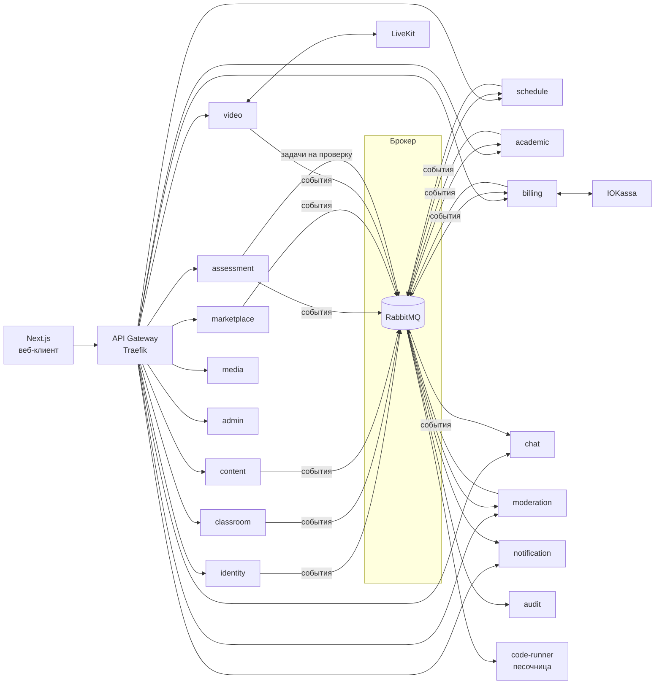

# Архитектура — образовательная платформа

Основа: ТЗ v1.2, [decisions.md](decisions.md), [mvp-plan.md](mvp-plan.md).
Стек: FastAPI, Next.js, PostgreSQL, RabbitMQ, Redis, S3 (SeaweedFS локально, Yandex Object Storage в облаке), LiveKit, Docker, Яндекс.Облако.

## 1. Общая схема



**Правила:**

1. **У каждого сервиса своя база данных.** Физически это один кластер PostgreSQL, но у каждого сервиса отдельная БД и отдельный пользователь. Сервис не читает чужие таблицы — только через API или события.
2. **Синхронно (REST)** — когда ответ нужен сразу: «есть ли у педагога доступ к этой группе», «хватает ли баланса».
3. **Асинхронно (RabbitMQ)** — всё остальное: уведомления, аудит, реакция других сервисов на событие.
4. **Transactional outbox.** Событие сначала пишется в таблицу `outbox` в той же транзакции, что и изменение данных, затем отдельный процесс публикует его в брокер. Так событие не потеряется, если брокер недоступен.
5. **Идемпотентные обработчики.** Каждое событие имеет `event_id`; получатель хранит обработанные id в `inbox` и не выполняет одно событие дважды.
6. **Таймеры в БД, а не в брокере.** Критичные отложенные действия (автоотмена занятия, выплата через час, напоминания) хранятся в таблице `scheduled_jobs` с полем `run_at`; воркер забирает созревшие задачи. Это переживает любые перезапуски.
7. **Аутентификация.** identity выдаёт JWT (access 15 мин + refresh). Gateway пропускает запросы, каждый сервис сам проверяет подпись по публичному ключу (JWKS). В токене: `user_id`, `roles`, `teacher_modes`.
8. **Время** — только UTC (`timestamptz`), конвертация на клиенте.
9. **Идентификаторы** — UUID v7 (сортируются по времени).

## 2. Сервисы

| # | Сервис | Отвечает за | Этап |
|---|---|---|---|
| 1 | **gateway** (Traefik) | Маршрутизация, TLS, rate limiting | 0 |
| 2 | **identity** | Аккаунты, пароли, 2FA, сессии, роли, JWT, удаление/обезличивание | 0 |
| 3 | **notification** | Email, web push, уведомления в приложении, WebSocket-канал | 0 |
| 4 | **audit** | Неизменяемый лог всех действий (читает все события) | 0 |
| 5 | **media** | Загрузка файлов в S3, presigned-ссылки, антивирус, типы и лимиты | 0 |
| 6 | **classroom** | Классы/группы, состав, связи педагог–ученик, приглашения, запросы на привязку | 1 |
| 7 | **schedule** | Занятия, серии, конфликты, переносы, отмены, напоминания | 1 |
| 8 | **academic** | Журнал (оценки, посещаемость), КТП, аналитика успеваемости, экспорт | 1–2 |
| 9 | **chat** | Все типы чатов, сообщения, вложения, объявления, WebSocket | 1 |
| 10 | **content** | Библиотека знаний: иерархия, материалы, прогресс, избранное | 2 |
| 11 | **assessment** | Задачи, тесты, ДЗ, попытки, проверка, результаты | 2 |
| 12 | **code-runner** | Выполнение Python-кода в изолированных контейнерах | 2 |
| 13 | **moderation** | Единая очередь модерации: контент, отзывы, верификация, споры | 2 |
| 14 | **video** | Комнаты LiveKit, токены доступа, записи, логи подключений, прокторинг | 3 |
| 15 | **marketplace** | Профиль репетитора, поиск, заявки, отклики, группы-наборы, отзывы | 4 |
| 16 | **billing** | Балансы, двойная запись, escrow, штрафы, выплаты, ЮKassa, чеки, подписки | 4–5 |
| 17 | **admin** | Настройки платформы, агрегированная аналитика, админ-операции | 5 |

**Общая библиотека** `platform-common` (Python-пакет в репозитории): проверка JWT, права доступа, outbox/inbox, клиент RabbitMQ, логирование, трассировка, базовые модели ошибок. Все сервисы устроены одинаково.

## 3. Брокер: как устроены события

- Один topic-exchange `events`. Ключ маршрутизации = имя события, например `schedule.lesson.cancelled`.
- Каждый сервис-получатель заводит свою очередь и подписывается на нужные шаблоны (`schedule.#`, `*.lesson.*`).
- Для задач, которые нужно выполнить один раз (проверка кода, отправка письма), — отдельные рабочие очереди: `code-runner.jobs`, `notification.email`.
- Неудачные сообщения — повтор с задержкой (3 попытки), затем dead-letter очередь для разбора.

**Формат события:**

```json
{
  "event_id": "0192f...",
  "type": "schedule.lesson.cancelled",
  "version": 1,
  "occurred_at": "2026-09-23T10:00:00Z",
  "actor_id": "user uuid",
  "data": { "lesson_id": "...", "cancelled_by": "teacher", "reason": "..." }
}
```

### Основные события

| Событие | Кто публикует | Кто слушает |
|---|---|---|
| `identity.user.registered` | identity | notification, audit |
| `identity.user.deleted` | identity | все сервисы (обезличивание) |
| `classroom.link.created` (педагог–ученик) | classroom | chat, audit |
| `classroom.member.added` / `removed` | classroom | chat, schedule |
| `schedule.lesson.created` / `updated` / `cancelled` | schedule | notification, billing, video, academic |
| `schedule.lesson.reschedule_requested` / `confirmed` | schedule | notification, billing |
| `schedule.lesson.started` / `finished` | schedule | billing (escrow), marketplace (предложить отзыв) |
| `schedule.lesson.unpaid_warning` | schedule | notification |
| `content.item.submitted` | content | moderation |
| `assessment.task.submitted` | assessment | moderation |
| `assessment.homework.assigned` / `graded` | assessment | notification, academic (автооценка) |
| `assessment.code.submitted` | assessment | code-runner |
| `coderunner.result.ready` | code-runner | assessment |
| `moderation.decision.made` | moderation | content / assessment / marketplace / billing, notification |
| `marketplace.request.published` | marketplace | notification (репетиторам по предмету) |
| `marketplace.request.agreed` | marketplace | classroom (привязка), schedule, notification |
| `marketplace.review.submitted` | marketplace | moderation |
| `billing.lesson.paid` / `refunded` | billing | schedule, video (доступ к звонку), notification |
| `billing.dispute.opened` / `resolved` | billing | moderation, notification |
| `billing.payout.completed` | billing | notification |
| `billing.subscription.changed` | billing | все, кто проверяет лимиты тарифа |
| `video.recording.ready` | video | notification |
| `video.proctoring.tab_switched` | video | WebSocket педагогу (через notification) |
| `*.*.*` (всё) | — | audit |

## 4. Схемы баз данных (ключевые таблицы)

Во всех БД есть служебные `outbox`, `inbox`, при необходимости `scheduled_jobs`. Поля `created_at` / `updated_at` подразумеваются.

### identity
- `users` — id, email (nullable, unique), login (unique), phone, password_hash, full_name, status (pending_verification / active / banned / deleted), two_factor_method (email / phone / null — только для аккаунтов без контактов), teacher_mode (school / tutor), managed_by_teacher_id, last_seen_at, timezone
- `user_roles` — user_id, role (student / teacher / moderator / admin)
- `otp_challenges` — одноразовые коды (подтверждение email, вход, сброс пароля): хэш кода, срок, попытки
- `refresh_tokens` — хэш токена, family_id (цепочка ротаций), revoked_at, revoke_reason
- Счётчики неудачных входов — в Redis
- `consents` — user_id, type (pdn), version, accepted_at

### classroom
- `people` — реплика имён пользователей из identity (события `identity.user.registered|updated|snapshot`)
- `groups` — id, teacher_id, kind (class / group), mode (school / tutor), title, subject, description, archived_at
- `group_members` — group_id, student_id, joined_at, left_at (история сохраняется)
- `teacher_student_links` — teacher_id, student_id, status (pending / active / declined / ended), source (invite / manual / request / marketplace), pending_group_id
- `invitations` — email, teacher_id, group_id, token, expires_at, accepted_at, revoked_at
- Создание аккаунта ученика и поиск по логину — синхронный вызов `identity /internal/...`

### schedule
- `people` — реплика имён из identity
- `lesson_series` — правило повторения (дни недели, раз в N недель, до даты / N занятий) и часовой пояс педагога
- `lessons` — id, series_id, teacher_id, mode (school / tutor), kind (individual / group), group_id, group_title, student_id, subject, topic, starts_at, ends_at, status (scheduled / cancelled), video_url, отмена (кто, когда, причина)
  - пересечения запрещены ограничением `EXCLUDE USING gist (teacher_id =, tstzrange(starts_at, ends_at) &&) WHERE status = 'scheduled'`
- `lesson_participants` — lesson_id, student_id; будущие групповые занятия следуют за составом группы (события `classroom.member.*`, `classroom.link.ended`)
- `reschedule_requests` — перенос индивидуального занятия, ждущий подтверждения второй стороны
- `scheduled_jobs` — напоминания за 24 и 2 часа; устаревшие (занятие перенесено/отменено) пропускаются
- Проверка доступа при создании — синхронно `classroom /internal/groups/{id}`, `/internal/links`
- Позже (этап 4): статус оплаты участника, автоотмена без оплаты

### academic
- `people` — реплика имён из identity
- `grade_types` — справочник типов оценок (ведёт модератор, без весов; значения по умолчанию — в миграции)
- `grades` — teacher_id, student_id, lesson_id, копия данных занятия (lesson_starts_at, group_id, subject), value 1–5, grade_type_id, comment (обязателен), source (manual / test)
- `attendance` — (lesson_id, student_id), status (present / absent / late / sick), копия данных занятия
- Столбцы журнала — занятия из `schedule /internal/lessons`, строки — состав из `classroom /internal/groups/{id}` плюс все, у кого есть записи
- Базовая аналитика: средний балл и доля посещённых занятий по ученику, группе, предмету
- Позже: КТП (этап 2), расширенная аналитика и экспорт (этап 5)

### content
- `subjects` — id, name
- `nodes` — id, parent_id, kind (course / section / module), subject_id, title, position, owner_id (null = публичный), visibility (public / private), moderation_status
- `materials` — id, node_id, kind (text / video / pdf / link / theory_card), title, body (JSON редактора), media_id, url, linked_task_id, moderation_status, version
- `material_progress` — user_id, material_id, viewed, position_sec, updated_at
- `favorites` — user_id, material_id

### assessment
- `tasks` — id, author_id, node_id, type (choice / short / long / code), statement, visibility, moderation_status, version
- `task_choices` — task_id, text, is_correct
- `task_answer_patterns` — task_id, mode (exact / regex), pattern
- `task_code_spec` — task_id, language, time_limit_s, memory_limit_mb
- `task_test_cases` — task_id, position, input, expected_output (скрыты от ученика)
- `tests` — id, author_id, title, order_mode (fixed / random), shuffle_choices, time_limit_mode (none / total / per_task), time_limit_s, proctoring
- `test_tasks` — test_id, task_id, position, points
- `assignments` — id, test_id, teacher_id, target (group / student), kind (homework / live), deadline, auto_grade_to_journal, plan_lesson_id
- `attempts` — id, assignment_id, student_id, attempt_no, started_at, submitted_at, status, score, task_order (JSON)
- `answers` — attempt_id, task_id, payload, is_correct, score, teacher_comment, checked_at
- `code_runs` — answer_id, status, failed_case_no, runtime_ms

### marketplace
- `tutor_profiles` — user_id, bio, photo_media_id, subjects, levels, formats, price_from, rating_avg, rating_count, education_verified, payments_enabled, is_searchable
- `education_docs` — id, tutor_id, title, year, institution, media_id, moderation_status, reject_comment
- `competencies` — id, subject_id, name (справочник модератора)
- `requests` — id, student_id, tutor_id (null = открытая), subject_id, goal, current_competencies, desired_competencies, schedule_pref (JSON), price, duration_min, comment, status (open / agreed / closed / expired), expires_at
- `request_responses` — request_id, tutor_id, chat_id, status
- `group_offers` — id, tutor_id, subject_id, program_template_id, schedule, price_per_student, min_students, max_students, enroll_until, status
- `group_enrollments` — offer_id, student_id, status, unpaid_streak
- `reviews` — id, tutor_id, student_id, rating (1–10), text, status, reply_text, reply_status

### billing
- `accounts` — id, owner_id, kind (student_balance / teacher_balance / escrow / platform_revenue / provider_clearing), currency
- `ledger_entries` — id, transaction_id, account_id, amount (дебет/кредит), created_at — **двойная запись**: сумма по транзакции всегда 0
- `transactions` — id, kind (topup / lesson_payment / escrow_release / refund / penalty / commission / payout / subscription), status, lesson_id, idempotency_key
- `lesson_payments` — lesson_id, student_id, amount, status (held / disputed / released / refunded), release_at
- `payment_intents` — id, user_id, provider (yookassa), method (sbp / sberpay / card), amount, provider_payment_id, status
- `payouts` — id, teacher_id, amount, status, provider_payout_id
- `payout_settings` — teacher_id, mode (manual / daily / weekly)
- `disputes` — id, lesson_id, student_id, status, resolution, resolved_by
- `verifications` — teacher_id, status (none / pending / approved / rejected), inn, legal_status, bank_details (зашифровано), documents, reject_comment
- `receipts` — transaction_id, source (fns_api / manual), media_id
- `subscriptions` — teacher_id, plan (free / basic), status, current_period_end
- Балансы не хранятся «числом», а считаются по `ledger_entries` (с кэшированным снимком). Все операции — в одной транзакции с блокировкой счёта.

### chat
- `conversations` — id, kind (direct / group / negotiation / lesson / support), ref_id (group_id / request_id / lesson_id / dispute_id)
- `conversation_members` — conversation_id, user_id, role, last_read_at
- `messages` — id, conversation_id, author_id, text, attachments (media ids), is_announcement, is_pinned, created_at

### video
- `rooms` — id, lesson_id | attempt_id, livekit_room_name, kind (lesson / proctoring), status
- `room_sessions` — room_id, user_id, joined_at, left_at (логи для споров)
- `recordings` — id, room_id, media_key, size, expires_at, owner_plan
- `proctoring_events` — room_id, student_id, kind (tab_hidden / window_blur / camera_opened), at

### moderation
- `queue_items` — id, kind (content / task / plan_template / review / review_reply / education_doc / verification / dispute), ref_service, ref_id, priority (для подписчиков), status, assignee_id, decision, comment, created_at — FIFO по (priority, created_at)

### notification
- `notifications` — id, user_id, kind, payload, read_at
- `push_subscriptions` — user_id, endpoint, keys
- `deliveries` — notification_id, channel (email / push), status, attempts

### media
- `files` — id, owner_id, bucket, key, mime, size, purpose, scan_status, expires_at

### audit
- `audit_log` — id, event_id, type, actor_id, occurred_at, data (JSONB). Только INSERT: у пользователя БД нет прав на UPDATE/DELETE. Партиционирование по месяцам.

## 5. Ключевые сценарии

### Оплата занятия и escrow
1. Ученик нажимает «Оплатить» → **billing** проверяет баланс; если не хватает — создаёт `payment_intent` в ЮKassa, после вебхука зачисляет на баланс.
2. billing переводит сумму: баланс ученика → счёт escrow, публикует `billing.lesson.paid`.
3. **schedule** отмечает участника как оплатившего; **video** разрешает ему вход в звонок.
4. За 2 ч до начала `scheduled_jobs` в schedule проверяет оплату → `schedule.lesson.unpaid_warning` → педагогу уведомление.
5. При старте без оплаты — автоотмена (`schedule.lesson.cancelled`).
6. По `schedule.lesson.finished` billing ставит `release_at = +1 час`.
7. Если за час пришёл спор — платёж `disputed`, задача в **moderation**. Иначе escrow → баланс педагога минус 10% комиссии на счёт платформы.

### Проверка кода
1. Ученик отправляет решение → **assessment** сохраняет ответ, кладёт задачу в очередь `code-runner.jobs`.
2. **code-runner** запускает код в одноразовом контейнере без сети, с лимитами CPU/памяти/времени, прогоняет тест-кейсы.
3. Результат (`passed` или номер упавшего кейса) → `coderunner.result.ready` → assessment → ученику через WebSocket.

### Открытая заявка
1. Ученик публикует заявку → **marketplace** → `marketplace.request.published` → **notification** рассылает репетиторам по предмету.
2. Репетитор откликается → **chat** создаёт чат переговоров.
3. «Договорились» → цена фиксируется, заявка закрывается, остальным — уведомление; **classroom** создаёт связь педагог–ученик.

## 6. Репозиторий и локальный запуск

Монорепозиторий:

```
edu-platform/
├── services/
│   ├── identity/          # FastAPI-сервис: app/, migrations/ (Alembic), tests/, Dockerfile
│   ├── classroom/
│   ├── ...
├── libs/
│   └── platform-common/   # общая Python-библиотека
├── web/                   # Next.js
├── compose.yaml           # локальный запуск всего
├── infra/
│   ├── docker/            # общий Dockerfile Python-сервисов
│   ├── postgres/          # создание баз для сервисов
│   ├── k8s/               # (позже) манифесты / Helm для облака
│   └── terraform/         # (позже) инфраструктура Яндекс.Облака
└── .github/workflows/     # CI/CD
```

**Локально** (`make up`): все сервисы, PostgreSQL, RabbitMQ (с веб-интерфейсом), Redis, SeaweedFS (S3), Traefik, Mailpit (перехват писем), Next.js; LiveKit добавится на этапе 3. Для сервисов — автоперезагрузка при изменении кода.

**Технологии внутри сервиса:** FastAPI, SQLAlchemy 2 (async), Alembic, Pydantic v2, aio-pika (RabbitMQ), pytest; OpenAPI генерируется автоматически, фронтенд генерирует из него типизированный клиент.

**Наблюдаемость:** структурированные JSON-логи, трассировка OpenTelemetry (request_id сквозь сервисы и события), метрики Prometheus. Локально — Grafana-стек опционально.
