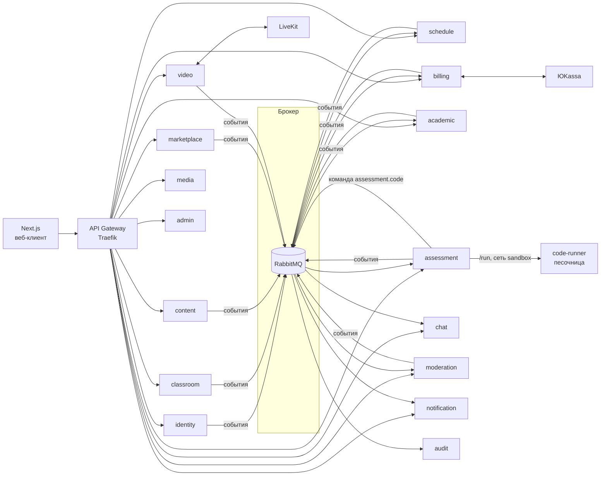

# Архитектура — образовательная платформа

Основа: ТЗ v1.2, [decisions.md](decisions.md), [mvp-plan.md](mvp-plan.md).
Стек: FastAPI, Next.js, PostgreSQL, RabbitMQ, Redis, S3 (SeaweedFS локально, Yandex Object Storage в облаке), LiveKit, Docker, Яндекс.Облако.

## 1. Общая схема



**Правила:**

1. **У каждого сервиса своя база данных.** Физически это один кластер PostgreSQL, но у каждого сервиса отдельная БД и отдельный пользователь. Сервис не читает чужие таблицы — только через API или события.
2. **Синхронно (REST)** — когда ответ нужен сразу: «есть ли у педагога доступ к этой группе», «хватает ли баланса».
3. **Асинхронно (RabbitMQ)** — всё остальное: уведомления, аудит, реакция других сервисов на событие.
4. **Transactional outbox.** Событие сначала пишется в таблицу `outbox` в той же транзакции, что и изменение данных, затем отдельный процесс публикует его в брокер. Так событие не потеряется, если брокер недоступен.
5. **Идемпотентные обработчики.** Каждое событие имеет `event_id`; получатель хранит обработанные id в `inbox` и не выполняет одно событие дважды.
6. **Таймеры в БД, а не в брокере.** Критичные отложенные действия (автоотмена занятия, выплата через час, напоминания) хранятся в таблице `scheduled_jobs` с полем `run_at`; воркер забирает созревшие задачи. Это переживает любые перезапуски.
7. **Аутентификация.** identity выдаёт JWT (access 15 мин + refresh). Gateway пропускает запросы, каждый сервис сам проверяет подпись по публичному ключу (JWKS). В токене: `user_id`, `roles`.
8. **Время** — только UTC (`timestamptz`), конвертация на клиенте.
9. **Идентификаторы** — UUID v7 (сортируются по времени).

## 2. Сервисы

| # | Сервис | Отвечает за | Этап |
|---|---|---|---|
| 1 | **gateway** (Traefik) | Маршрутизация, TLS, rate limiting | 0 |
| 2 | **identity** | Аккаунты, пароли, 2FA, сессии, роли, JWT, удаление/обезличивание | 0 |
| 3 | **notification** | Email, web push, уведомления в приложении, WebSocket-канал | 0 |
| 4 | **audit** | Неизменяемый лог всех действий (читает все события) | 0 |
| 5 | **media** | Загрузка файлов в S3, presigned-ссылки, антивирус, типы и лимиты | 0 |
| 6 | **classroom** | Классы/группы, состав, связи педагог–ученик, приглашения, запросы на привязку | 1 |
| 7 | **schedule** | Занятия, серии, конфликты, переносы, отмены, напоминания | 1 |
| 8 | **academic** | Журнал (оценки, посещаемость), КТП, аналитика успеваемости, экспорт | 1–2 |
| 9 | **chat** | Все типы чатов, сообщения, вложения, объявления, WebSocket | 1 |
| 10 | **content** | Библиотека знаний: иерархия, материалы, прогресс, избранное | 2 |
| 11 | **assessment** | Задачи, тесты, ДЗ, попытки, проверка, результаты | 2 |
| 12 | **code-runner** | Выполнение Python-кода в изолированных контейнерах | 2 |
| 13 | **moderation** | Единая очередь модерации: контент, отзывы, верификация, споры | 2 |
| 14 | **video** | Комнаты LiveKit, токены доступа, записи, логи подключений, прокторинг | 3 |
| 15 | **marketplace** | Профиль репетитора, поиск, заявки, отклики, группы-наборы, отзывы | 4 |
| 16 | **billing** | Балансы, двойная запись, escrow, штрафы, выплаты, ЮKassa, чеки, подписки | 4–5 |
| 17 | **admin** | Настройки платформы, агрегированная аналитика, админ-операции | 5 |

**Общая библиотека** `platform-common` (Python-пакет в репозитории): проверка JWT, права доступа, outbox/inbox, клиент RabbitMQ, логирование, трассировка, базовые модели ошибок. Все сервисы устроены одинаково.

## 3. Брокер: как устроены события

- Один topic-exchange `events`. Ключ маршрутизации = имя события, например `schedule.lesson.cancelled`.
- Каждый сервис-получатель заводит свою очередь и подписывается на нужные шаблоны (`schedule.#`, `*.lesson.*`).
- Для задач, которые нужно выполнить один раз (проверка кода, отправка письма), — отдельные рабочие очереди (команды): `assessment.code`, `notification.email`.
- Неудачные сообщения — повтор с задержкой (3 попытки), затем dead-letter очередь для разбора.

**Формат события:**

```json
{
  "event_id": "0192f...",
  "type": "schedule.lesson.cancelled",
  "version": 1,
  "occurred_at": "2026-09-23T10:00:00Z",
  "actor_id": "user uuid",
  "data": { "lesson_id": "...", "cancelled_by": "teacher", "reason": "..." }
}
```

### Основные события

| Событие | Кто публикует | Кто слушает |
|---|---|---|
| `identity.user.registered` | identity | notification, audit |
| `identity.user.deleted` | identity | все сервисы (обезличивание) |
| `classroom.link.created` (педагог–ученик) | classroom | chat, audit |
| `classroom.member.added` / `removed` | classroom | chat, schedule |
| `schedule.lesson.created` / `updated` / `cancelled` | schedule | notification, billing, video, academic |
| `schedule.lesson.reschedule_requested` / `confirmed` | schedule | notification, billing |
| `schedule.lesson.trial_finished` (через 5 минут после конца пробного) | schedule | marketplace (опрос ученика) |
| `schedule.lesson.started` / `finished` | schedule | billing (escrow) — с оплатой занятий |
| `schedule.lesson.unpaid_warning` | schedule | notification |
| `content.item.submitted` | content | moderation |
| `assessment.task.submitted` | assessment | moderation |
| `assessment.homework.assigned` / `graded` | assessment | notification, academic (автооценка) |
| `assessment.task.published` / `rejected` / `unpublished` / `deleted` | assessment | moderation, notification |
| `assessment.submission.checked` / `reviewed` | assessment | notification (проверка педагогом) |
| `moderation.decision.made` | moderation | content / assessment / marketplace / billing, notification |
| `marketplace.request.published` | marketplace | notification (репетиторам по предмету) |
| `marketplace.request.agreed` | marketplace | classroom (привязка), schedule, notification |
| `marketplace.review.submitted` / `reply_submitted` / `disputed` / `withdrawn` / `removed` | marketplace | moderation (очередь), chat (спор → чат поддержки) |
| `marketplace.review.approved` / `rejected` / `reply_approved` / `reply_rejected` / `dispute_resolved` | marketplace | notification, chat |
| `billing.lesson.paid` / `refunded` | billing | schedule, video (доступ к звонку), notification |
| `billing.dispute.opened` / `resolved` | billing | moderation, notification |
| `billing.payout.completed` | billing | notification |
| `billing.subscription.changed` / `expiring`, `billing.payment.failed` | billing | moderation (приоритет), notification; classroom и video спрашивают тариф через `/internal/plans` |
| `video.recording.ready` | video | notification |
| `video.proctoring.tab_switched` | video | WebSocket педагогу (через notification) |
| `*.*.*` (всё) | — | audit |

## 4. Схемы баз данных (ключевые таблицы)

Во всех БД есть служебные `outbox`, `inbox`, при необходимости `scheduled_jobs`. Поля `created_at` / `updated_at` подразумеваются.

### identity
- `users` — id, email (nullable, unique), login (unique), phone, password_hash, full_name, status (pending_verification / active / banned / deleted), two_factor_method (email / phone / null — только для аккаунтов без контактов), managed_by_teacher_id, last_seen_at, timezone
- `user_roles` — user_id, role (student / teacher / moderator / admin)
- `otp_challenges` — одноразовые коды (подтверждение email, вход, сброс пароля): хэш кода, срок, попытки
- `refresh_tokens` — хэш токена, family_id (цепочка ротаций), revoked_at, revoke_reason
- Счётчики неудачных входов — в Redis
- `consents` — user_id, type (pdn), version, accepted_at

### Админ-панель
Отдельного сервиса нет: у каждого сервиса свой `/admin/...` (роль admin), веб собирает страницы из них.
- identity: пользователи — поиск и фильтры, правка имени/email/логина, роли (снять admin с себя нельзя), блокировка (все сессии отзываются; выданный access-токен доживает до 15 минут), удаление с восстановлением 30 дней и затем обезличиванием (фоновая задача; имя в репликах — «Удалённый пользователь», решение №9), временный пароль; `user_activity` (день активности при входе и продлении сессии) — DAU/WAU/MAU и регистрации по дням
- audit: история пользователя (`?user_id=` — действовал сам или событие о нём), `/audit/stats` — активность по типам событий и топ педагогов по действиям в учёбе
- Снятие контента без очереди модерации (`/admin/.../remove|restore`): курсы (content), задачи (assessment), шаблоны КТП (academic) получают статус `removed` с причиной в `review_comment` и прежним статусом в `removed_from` (отмена возвращает его). Контент исчезает из библиотеки, банка и у учеников автора, но уже выданные тесты, прогресс и КТП продолжают работать; автору — уведомление с причиной, заявки в очереди модерации снимаются. Наборы в группы (marketplace) отменяются или закрываются; профиль репетитора скрывается с запретом включать показ (`blocked_reason`). Отзывы — прежний `DELETE /moderation/reviews/{id}`
- billing: настройки платформы `platform_settings` (цена тарифа, лимиты бесплатной версии, срок хранения записей, параметры комиссии и escrow на будущее) — отдаются сервисам через `/internal/settings`, кэш 30 секунд в `testmatica_common.plans`, по умолчанию — `PLATFORM_DEFAULTS`; платежи, выручка по месяцам, число подписчиков; подключение «Базового» без оплаты с причиной

### classroom
- `people` — реплика имён пользователей из identity (события `identity.user.registered|updated|snapshot`)
- `groups` — id, teacher_id, kind (class / group), paid (платные занятия или бесплатные), title, subject, description, archived_at
- `group_members` — group_id, student_id, joined_at, left_at (история сохраняется)
- `teacher_student_links` — teacher_id, student_id, status (pending / active / declined / ended), source (invite / manual / request / marketplace), paid (индивидуальные занятия платные — независимо от групп ученика), pending_group_id
- `invitations` — email, teacher_id, group_id, token, expires_at, accepted_at, revoked_at
- Ученики списком: `POST /students/manual/bulk` (до 40 имён; каждый создаётся отдельно через identity, ошибки — в ответе) и `POST /students/cards.pdf` — лист A4 с карточками для вырезания (логин, пароль, QR-код на вход с подставленным логином). Пароли не хранятся в открытом виде, поэтому карточки печатаются только сразу после создания
- `GET /internal/teachers/{id}/groups` — группы педагога с составом (для сводной ведомости в academic)
- Создание аккаунта ученика и поиск по логину — синхронный вызов `identity /internal/...`

### schedule
- `people` — реплика имён из identity
- `lesson_series` — правило повторения (дни недели, раз в N недель, до даты / N занятий) и часовой пояс педагога
- `lessons` — id, series_id, teacher_id, paid (берётся от группы или ученика при создании, у занятия можно поменять), kind (individual / group), group_id, group_title, student_id, subject, topic, starts_at, ends_at, status (scheduled / cancelled), video_url, отмена (кто, когда, причина)
  - пересечения запрещены ограничением `EXCLUDE USING gist (teacher_id =, tstzrange(starts_at, ends_at) &&) WHERE status = 'scheduled'`
- `lesson_participants` — lesson_id, student_id; будущие групповые занятия следуют за составом группы (события `classroom.member.*`, `classroom.link.ended`)
- `reschedule_requests` — перенос индивидуального занятия, ждущий подтверждения второй стороны
- `scheduled_jobs` — напоминания за 24 и 2 часа; устаревшие (занятие перенесено/отменено) пропускаются
- Проверка доступа при создании — синхронно `classroom /internal/groups/{id}`, `/internal/links`
- Позже (этап 4): статус оплаты участника, автоотмена без оплаты

- У занятия, кроме темы, — `exam_item_ids`: задания ЕГЭ/ОГЭ, которые на нём разбираются (каталог — в assessment, здесь только id)
### academic
- `people` — реплика имён из identity
- Аналитика (`/analytics/groups/{id}`, `/analytics/students/{id}`, `/analytics/summary`) — по своим таблицам `grades` и `attendance` за период в часовом поясе педагога. Всем — средний балл и посещаемость; на тарифе «Базовый» (`billing /internal/plans`) — динамика по неделям, отклонение ученика от среднего по классу, распределение оценок, тепловая карта пропусков по дням, сводная ведомость и выгрузка в Excel (openpyxl) и PDF (reportlab, шрифты DejaVu/Comfortaa из образа)
- `grade_types` — справочник типов оценок (ведёт модератор, без весов; значения по умолчанию — в миграции)
- `grades` — teacher_id, student_id, lesson_id, копия данных занятия (lesson_starts_at, group_id, subject), value 1–5, grade_type_id, comment (обязателен), source (manual / test)
- `attendance` — (lesson_id, student_id), status (present / absent / late / sick), копия данных занятия
- Столбцы журнала — занятия из `schedule /internal/lessons`, строки — состав из `classroom /internal/groups/{id}` плюс все, у кого есть записи
- Базовая аналитика: средний балл и доля посещённых занятий по ученику, группе, предмету
- Позже: расширенная аналитика и экспорт (этап 5)

- Оценки из тестов: `source = test`, `source_ref` — id выданной работы (пересдача обновляет оценку); ставятся по событию `assessment.attempt.graded`, если педагог выбрал урок и «оценку в журнал»
- КТП (этап 2.5):
  - `plan_templates` / `template_lessons` — шаблон: уроки без дат (тема, планируемые результаты, материалы «к уроку» и «на дом» — ссылки на модули content, тесты assessment, внешние ссылки и заметки; задания ЕГЭ/ОГЭ); свой, копия чужого или публичный через модерацию (`academic.plan_template.submitted` → moderation, kind = plan_template)
  - `plans` / `plan_lessons` — КТП группы или ученика: копия уроков шаблона (или пустой план, заполняемый постепенно), даты и занятие расписания у каждого урока; к одному занятию можно привязать несколько уроков
  - «Проставить даты»: непройденные уроки по порядку ложатся на занятия цели из `schedule /internal/lessons` начиная с даты; пройденные не сдвигаются
  - Темы КТП показываются в журнале (у колонки урока) и в карточке занятия
### content
- `subjects` — справочник предметов (значения по умолчанию — в миграции)
- `nodes` — курс / раздел / модуль (parent_id, course_id — корень), owner_id, title, description, position; у курса — status (private / pending / published / rejected), review_comment, published_at
- `materials` — kind (text / card / video / pdf / file / link / task), task_id — задача из банка assessment (только с автопроверкой), body (Markdown с формулами LaTeX), файл из media (id, имя, тип, размер), url, position
- `material_progress` — просмотрено, позиция видео; `favorites`
- Реплики: `people` (имена авторов), `rel_links` (ученики видят приватную библиотеку своих педагогов)
- Доступ: опубликованное — всем, включая гостей (`auth.optional`); приватное — автору, модераторам и привязанным ученикам; на модерации курс заблокирован для правок
- Сайт: `site_settings` (key = landing — разделы главной по схеме `app/site.py`: первый экран, цифры, преимущества, «как это работает», преподаватели — id репетиторов с подписью, новости, FAQ, контакты, видимость разделов; по умолчанию — наполнение из ТЗ) и `news` (slug, Markdown, обложка, черновик/опубликована). Публично — `/site/landing`, `/site/news`; редактирует администратор (`/admin/site/...`). Картинки — media с целью `site`. Главная и новости рендерятся на сервере Next (кэш 30 с, `INTERNAL_API_ORIGIN` — шлюз внутри Docker), карточки преподавателей — `marketplace /tutors?ids=` (только опубликованные профили)
- Публикация: `content.course.submitted` → очередь moderation → `moderation.decision.made` → `content.course.published|rejected`; курсы модераторов публикуются сразу
- Конструктор курсов: в модуль рядом с теорией добавляются задачи из банка (`assessment /internal/tasks/lookup` — доступна ли и с автопроверкой ли); при отправке курса на модерацию свои неопубликованные задачи идут вместе с ним
- Отчёт о просмотрах для педагога — по группе (`classroom /internal/groups`) или ученику

### moderation
- `queue_items` — kind, ref_id, title, author_id, details, priority, status (pending / approved / rejected / withdrawn), comment, decided_by; одна открытая заявка на объект
- Очередь FIFO (сначала приоритет — для подписчиков на этапе 5, затем время поступления); отклонение — только с комментарием
- Заявки создаются событиями других сервисов (`content.course.submitted`, `marketplace.review.*` …), решение уходит событием `moderation.decision.made`; повторное событие по открытой заявке обновляет её (автор отредактировал до проверки)

### assessment
Этап 2.3 — банк задач и решения (тесты, ДЗ и КТП — этапы 2.4–2.5):
- `topics` — общий рубрикатор «предмет → раздел → тема» (subject_id и название — из справочника content, parent_id — раздел); ведут модераторы, базовый набор создаётся фоновой задачей при пустой таблице
- `tasks` — owner_id, topic_id (предмет задачи берётся из темы; без темы задачу нельзя отправить в публичный банк), type (choice / short / long / code), title, statement (Markdown + LaTeX), subject, difficulty 1–3, tags (GIN-индекс), explanation, file_mode (none / optional / required — файл с развёрнутым ответом), answers (JSON: exact / regex), для кода — language, starter_code, time_limit_s, memory_limit_mb; status (private / pending / published / rejected), based_on_id (копия из банка)
- `task_options` — task_id, text, is_correct; `task_tests` — task_id, position, input, expected (скрыты от ученика)
- `exams` / `exam_items` — каталог ЕГЭ и ОГЭ: экзамен по предмету и его задания по номерам (нумерация ФИПИ, правят модераторы); у задачи `exam_item_ids` — к каким заданиям она относится
- `exam_marks` — отметки педагога по заданиям экзамена для ученика или группы: «пройдено» (с датой) и примечание (ученику не показывается)
- Прогресс по заданию экзамена считается на лету из `submissions`: сколько разных задач пробовал, сколько решил верно, попытки; для группы — по составу из `classroom /internal/groups`
- `course_tasks` — какие задачи стоят в курсах (для модерации пакетом с курсом)
- `submissions` — student_id, task_id, context (practice — модуль курса / assignment — ДЗ), answer (JSON: варианты, текст или **полный код каждой попытки**), files (из media, purpose `answer`), status (checking / correct / incorrect / error / pending_review / reviewed), score, failed_case, failure, run_log (протокол по тестам — только педагогу), teacher_comment
- `tests` / `test_items` — тест педагога: задачи из банка с баллами, порядок (как в списке / случайный), перемешивание вариантов, таймер (нет / на весь тест / на каждое задание)
- `assignments` — назначение теста группе или ученику: просто тест, ДЗ к уроку или тест на уроке (завершает педагог); своё название для учеников (`title`) и название теста на момент назначения (`test_title`); окно `opens_at`–`deadline`, `max_attempts` (null — без ограничений, засчитывается лучшая попытка); копия состава и настроек, урок в расписании (колонка журнала; обязателен для ДЗ и теста на уроке), «оценка в журнал» и тип оценки
- `assignment_students` — кому назначено: число разрешённых попыток (от `max_attempts`, растёт при переназначении), личный дедлайн
- `attempts` — попытка: свой порядок заданий и вариантов, таймер, сдача (вручную или автоматически по времени/дедлайну/завершению), баллы, процент, оценка (85/65/45 % → 5/4/3, ниже — 2)
- `attempt_answers` — черновики ответов до сдачи; при сдаче превращаются в `submissions` (context_type = assignment, context_id = попытка) и проверяются как обычно; итог пересчитывается, когда проверен код или развёрнутый ответ
- Прокторинг (тариф «Базовый», проверка через `billing /internal/plans`): флаг `proctoring` у назначения; новая попытка — только с согласием (`attempts.proctor_consent_at`); `proctor_events` — журнал попытки (согласие, показ экрана, уход со вкладки и из окна, камера); `GET /internal/proctoring/{assignment_id}?user_id=` — для video: педагог назначения или ученик с идущей попыткой
- События: `assessment.assignment.created|reassigned`, `assessment.attempt.started|submitted|graded` (graded несёт лучшую проверенную попытку → academic ставит или обновляет оценку, notification — уведомление)
- Проверка: выбор и короткий ответ — сразу (нормализация регистра, пробелов, ё/е, запятой); код — команда `assessment.code` → code-runner; развёрнутый ответ — педагог ученика
- Педагог видит историю ученика (`GET /students/{id}/submissions`) — только у привязанных учеников (реплика `rel_links`)
- Реплики: `people`, `rel_links`

### code-runner
- Без БД и без брокера: только `POST /run` с внутренним токеном, во внутренней Docker-сети `sandbox` (`internal: true`) — выхода в интернет нет, из других сервисов доступен только assessment
- Контейнер: read-only ФС, tmpfs /tmp, без capabilities, no-new-privileges, лимит процессов и памяти, пользователь nobody
- Каждый запуск: отдельный процесс `python -I` с rlimit (CPU, память, размер файлов, дескрипторы, процессы), пустое окружение; остановка на первом упавшем тесте
- В облаке — отдельная группа узлов (или gVisor/Firecracker) без доступа в сеть

### marketplace
Этап 4.1 (сделано):
- `tutor_profiles` — user_id, published («Показывать меня в поиске»; включается только у заполненного профиля), headline, about, photo_file_id (media, purpose avatar), subjects / subject_ids (справочник content), levels (1-4 / 5-9 / 10-11 / student / adult), formats (individual / group), price (ориентир за 60 минут), experience_years, rating, reviews_count, education_verified
- `education_docs` — user_id, title, institution, year, file_id (media, purpose document), status (pending / approved / rejected), comment; проверка — очередь moderation (kind = education_doc), бейдж «Образование подтверждено» — при хотя бы одном одобренном документе. Гостю виден только бейдж, вошедшим — список документов без файлов, файл — только модератору
- Поиск `GET /tutors` и профиль `GET /tutors/{id}` открыты без входа (ссылка «Поделиться»); онлайн-статус — из `identity /internal/users/presence` (last_seen_at обновляется при входе и продлении сессии)
Этап 4.2 (сделано):
- `competencies` — справочник по предметам (ведут модераторы, базовый набор создаётся фоновой задачей)
- `requests` — заявка ученика: адресная (tutor_id, «Хочу с вами заниматься») или открытая (видят репетиторы предмета с включённым профилем); цель, «что знаю» / «что хочу», удобное время, цена ученика, длительность 30/45/60/90, комментарий; open → agreed / closed / expired (14 дней)
- `responses` — переговоры репетитора по заявке: текущая цена и чьё это предложение; «Договорились» — только принять цену другой стороны. Id отклика = id чата переговоров (chat, kind = deal; писать можно без привязки — решение №12; служебные сообщения о цене и итоге)
- `marketplace.deal.agreed` → classroom: привязка ученика, индивидуальные занятия платные, цена и длительность (для оплаты на этапе 4.4); остальные отклики закрываются с уведомлением
Этап 4.3 (сделано):
- `reviews` — tutor_id, student_id (один отзыв от ученика педагогу), rating 1–10, text, status (pending / approved / rejected / removed), comment модератора, published_at; ответ педагога — reply_text / reply_status / reply_comment; спор — dispute_id (= id чата поддержки), dispute_reason, dispute_status (open / upheld / dismissed), dispute_comment
- Оставить отзыв может ученик, привязанный к педагогу (в том числе бывший) — проверка через `classroom /internal/links`. Правка отзыва отправляет его на повторную проверку и снимает прежние ответ и спор
- Отзыв, ответ и спор проверяются в moderation (kind = review / review_reply / review_dispute); решение приходит в `moderation.decision.made`. Спор «одобрен» — отзыв снимается (removed); модератор может снять отзыв и напрямую (`DELETE /moderation/reviews/{id}`)
- Рейтинг профиля (`rating`, `reviews_count`) пересчитывается по опубликованным отзывам — средняя оценка с одним знаком; фильтр «минимальный рейтинг» и сортировка поиска — по нему
Этап 4.5 (сделано, кроме оплаты):
- `group_offers` — набор в группу: tutor_id, title, subject, levels, description, program (темы по порядку, можно взять из своего шаблона КТП), schedule (дни, время, длительность, первое занятие, число занятий, часовой пояс), price (за занятие с ученика; 0 — бесплатно), min_students / max_students (до 15), enroll_until, private (закрытая — только по ссылке), status (recruiting / underfilled / started / closed / cancelled)
- `group_enrollments` — запись ученика = зарезервированное место; отменить можно до запуска
- Набрался минимум → уведомление педагогу; педагог запускает группу (`marketplace.group_offer.started`; перед этим — лимит групп тарифа через `classroom /internal/group-limit`). classroom создаёт группу **с id набора**, привязывает учеников (source = marketplace) и добавляет в группу; дальше всё как у обычной группы (чат, расписание). Форма расписания открывается с серией занятий из карточки. В идущую группу можно войти, пока есть места и набор не закрыт (`marketplace.group_offer.joined` → classroom добавляет ученика)
- Срок набора прошёл без минимума → underfilled (фоновая задача), педагог продлевает (`/extend`, при необходимости сдвигая первое занятие) или отменяет
- `trial_followups` — после пробного занятия (`schedule.lesson.trial_finished`) ученику: оставить отзыв и ответить «продолжу / не буду»; ответ — педагогу уведомлением
Дальше (с оплатой занятий):
- «3 неоплаченных занятия подряд» в группе, оплата перед каждым занятием, платные пробные через escrow, споры по занятиям

### billing
Сделано (подписка педагога, провайдер пока поддельный):
- `subscriptions` — user_id, plan (basic), period_start / period_end (тариф «Базовый» действует, пока period_end в будущем; иначе — бесплатный), auto_renew, payment_method_id / payment_method_title (сохранённый у провайдера способ оплаты), renew_failures, reminded_at, expired_at
- `payments` — user_id, purpose (subscription), amount_kop, status (pending / succeeded / canceled), provider, provider_payment_id, confirmation_url (страница оплаты), recurring (автопродление), save_method
- Провайдеры — интерфейс `create` (платёж со страницей оплаты) и `charge` (списание сохранённым способом). Поддельный (`PAYMENT_PROVIDER=fake`): страница оплаты — `/dashboard/pay/<id>` на сайте, результат — `POST /fake-provider/payments/<id>` (карта •• 0002 — отказ). ЮKassa подключится тем же интерфейсом
- Фоновая задача раз в 5 минут: автопродление за сутки до конца (после неудачи — не чаще раза в 6 часов, после 3 неудач автопродление выключается), напоминание за 3 дня без автопродления, возврат на бесплатный тариф
- События: `billing.subscription.changed` (reason: purchased / renewed / expired / auto_renew_on / auto_renew_off), `billing.subscription.expiring`, `billing.payment.succeeded|failed`
- Тариф для лимитов: `POST /internal/plans {user_ids}` → free / basic; в сервисах — `testmatica_common.plans.Plans` (кэшируется только «Базовый», коротко). Лимиты: classroom — до 3 активных групп; video — 40 минут на бесплатных занятиях, записи 3 шт. / 14 дней (на «Базовом» — без лимитов, 30 дней; при недоступном billing — как бесплатный); moderation — реплика `subscribers`, их заявки первыми
Дальше (оплата занятий, этап 4.4):
- `accounts` — id, owner_id, kind (student_balance / teacher_balance / escrow / platform_revenue / provider_clearing), currency
- `ledger_entries` — id, transaction_id, account_id, amount (дебет/кредит), created_at — **двойная запись**: сумма по транзакции всегда 0
- `transactions` — id, kind (topup / lesson_payment / escrow_release / refund / penalty / commission / payout / subscription), status, lesson_id, idempotency_key
- `lesson_payments` — lesson_id, student_id, amount, status (held / disputed / released / refunded), release_at
- `payment_intents` — id, user_id, provider (yookassa), method (sbp / sberpay / card), amount, provider_payment_id, status
- `payouts` — id, teacher_id, amount, status, provider_payout_id
- `payout_settings` — teacher_id, mode (manual / daily / weekly)
- `disputes` — id, lesson_id, student_id, status, resolution, resolved_by
- `verifications` — teacher_id, status (none / pending / approved / rejected), inn, legal_status, bank_details (зашифровано), documents, reject_comment
- `receipts` — transaction_id, source (fns_api / manual), media_id
- Балансы не хранятся «числом», а считаются по `ledger_entries` (с кэшированным снимком). Все операции — в одной транзакции с блокировкой счёта.

### chat
- Реплики: `people` (identity), `rel_links`, `rel_groups`, `rel_group_members` (classroom; события `classroom.group|member|link.*`, для заполнения — `*.snapshot`)
- `conversations` — kind (direct / group / deal / support), group_id (один чат на группу) или pair_key (один диалог на пару), pinned_message_id, last_message_at
- `conversation_members` — user_id, role (teacher / member), joined_at, left_at, last_read_at (непрочитанные считаются от него)
- `messages` — author_id, text, is_announcement, created_at, deleted_at (мягкое удаление; история бессрочно)
- Чат поддержки (kind = support): открывается по `marketplace.review.disputed` (id = dispute_id), участники — педагог и все модераторы/админы из реплики `people`; итог спора — служебным сообщением. Позже его заменит раздел «Поддержка»
- Личные сообщения — только при связи (привязка педагог–ученик или общая активная группа); без связи диалог только для чтения
- Реальное время: WebSocket `/ws` (первое сообщение — access-токен), доставка через Redis pub/sub `chat:user:<id>`
- Уведомления: команда `notification.inapp` с `coalesce_key` — одно непрочитанное уведомление на чат; в аудит — событие без текста
- Вложения: до 10 файлов на сообщение (через media); свежая ссылка — `GET /conversations/{id}/attachments/{file_id}`
- Позже: чат переговоров (этап 4), чат в занятии (этап 3), поддержка

### video
Этап 3 — видеосвязь на LiveKit (прокторинг — позже):
- `rooms` — комната занятия (lesson_id, в LiveKit — `lesson-<id>`): ёмкость (1+1 / 15+1, +1 место для записи), лимит времени (бесплатный тариф — 40 минут от первого входа), started_at / ended_at / end_reason (teacher / time_limit / empty), ученики с правом показывать экран
- `connections` — лог подключений по вебхукам LiveKit (кто, когда вошёл и вышел) — для споров об оплате
- `recordings` — запись (egress → MP4 в корзину `recordings` в S3): статус, размер, длительность, срок хранения (14 дней, не больше 3 у педагога — новая вытесняет старую), кому видна (педагог и ученики занятия)
- Вход: `POST /rooms/{lesson}/join` — занятие берётся из `schedule /internal/lessons/{id}/room`; пропуск (JWT LiveKit) — только педагогу и ученикам занятия, в окне за 30/15 минут до начала и до 30 минут после конца; права публикации: ученику экран — только с разрешения педагога
- Прокторинг: комната `proctor-<assignment_id>`; доступ решает assessment. Ученик может публиковать только экран и камеру и никого не видит; педагог невидим, только смотрит и шлёт сообщения по каналу данных (тема `proctor`: запрос камеры, «пришлите состояние»); ученик шлёт сигналы и состояние. Экран ученика пишется отдельной записью дорожки (track egress, без перекодирования) в `proctor_recordings`, хранится 14 дней, смотрит только педагог
- Вебхуки LiveKit — `/internal/webhooks/livekit` (наружу не публикуется, проверяется подпись): participant_joined/left, room_finished, egress_ended
- Фоновая задача: закрыть комнату по лимиту времени, удалить просроченные записи
- События: `video.room.started|ended`, `video.recording.ready` (→ уведомление участникам)
- Инфраструктура: `livekit` (сигнализация ws://…:7880, медиа UDP 50000–50060 / TCP 7881) и `egress` (headless Chrome, пишет в S3). Локально LiveKit объявляет адрес компьютера в сети (`LIVEKIT_NODE_IP`, его выставляет Makefile), чтобы до него дотягивались и браузер, и контейнер записи. В облаке — отдельная ВМ с публичным IP, TLS (wss://) и встроенным TURN для учеников за строгими NAT.

### moderation
- `queue_items` — id, kind (content / task / plan_template / review / review_reply / education_doc / verification / dispute), ref_service, ref_id, priority (для подписчиков), status, assignee_id, decision, comment, created_at — FIFO по (priority, created_at)

### notification
- `notifications` — id, user_id, kind, payload, read_at
- `push_subscriptions` — user_id, endpoint, keys
- `deliveries` — notification_id, channel (email / push), status, attempts

### media
- `files` — owner_id, purpose (chat_attachment / answer / material / avatar), filename, mime (по расширению), size, key в S3, status, claimed_by (какой сервис прикрепил)
- Загрузка через сервис (multipart), скачивание — временные подписанные ссылки S3 (картинки, PDF, видео — в браузере, остальное — скачивание)
- Ограничения по назначению: типы файлов и размер (вложения и ответы — 20 МБ, материалы — 500 МБ, фото — 5 МБ)
- Прикрепление: `POST /internal/files/claim` — проверка владельца и назначения; ссылки: `POST /internal/files/urls` — вызывает сервис-владелец сущности после своей проверки доступа
- Локально — SeaweedFS, в облаке — Yandex Object Storage; антивирусная проверка — позже

### audit
- `audit_log` — id, event_id, type, actor_id, occurred_at, data (JSONB). Только INSERT: у пользователя БД нет прав на UPDATE/DELETE. Партиционирование по месяцам.

## 5. Ключевые сценарии

### Оплата занятия и escrow
1. Ученик нажимает «Оплатить» → **billing** проверяет баланс; если не хватает — создаёт `payment_intent` в ЮKassa, после вебхука зачисляет на баланс.
2. billing переводит сумму: баланс ученика → счёт escrow, публикует `billing.lesson.paid`.
3. **schedule** отмечает участника как оплатившего; **video** разрешает ему вход в звонок.
4. За 2 ч до начала `scheduled_jobs` в schedule проверяет оплату → `schedule.lesson.unpaid_warning` → педагогу уведомление.
5. При старте без оплаты — автоотмена (`schedule.lesson.cancelled`).
6. По `schedule.lesson.finished` billing ставит `release_at = +1 час`.
7. Если за час пришёл спор — платёж `disputed`, задача в **moderation**. Иначе escrow → баланс педагога минус 10% комиссии на счёт платформы.

### Проверка кода
1. Ученик отправляет решение → **assessment** сохраняет код (статус `checking`) и в той же транзакции кладёт команду в очередь `assessment.code`.
2. Обработчик очереди (по одному сообщению) вызывает **code-runner** `/run`: код выполняется без сети, с лимитами CPU/памяти/времени, по тест-кейсам.
3. Результат (верно или номер упавшего теста и причина) сохраняется в попытке; ученик видит его в интерфейсе (опрос раз в ~1 с), педагог — ещё и протокол по тестам.

### Открытая заявка
1. Ученик публикует заявку → **marketplace** → `marketplace.request.published` → **notification** рассылает репетиторам по предмету.
2. Репетитор откликается → **chat** создаёт чат переговоров.
3. «Договорились» → цена фиксируется, заявка закрывается, остальным — уведомление; **classroom** создаёт связь педагог–ученик.

## 6. Репозиторий и локальный запуск

Монорепозиторий:

```
edu-platform/
├── services/
│   ├── identity/          # FastAPI-сервис: app/, migrations/ (Alembic), tests/, Dockerfile
│   ├── classroom/
│   ├── ...
├── libs/
│   └── platform-common/   # общая Python-библиотека
├── web/                   # Next.js
├── compose.yaml           # локальный запуск всего
├── infra/
│   ├── docker/            # общий Dockerfile Python-сервисов
│   ├── postgres/          # создание баз для сервисов
│   ├── k8s/               # (позже) манифесты / Helm для облака
│   └── terraform/         # (позже) инфраструктура Яндекс.Облака
└── .github/workflows/     # CI/CD
```

**Локально** (`make up`): все сервисы, PostgreSQL, RabbitMQ (с веб-интерфейсом), Redis, SeaweedFS (S3), Traefik, Mailpit (перехват писем), Next.js; LiveKit добавится на этапе 3. Для сервисов — автоперезагрузка при изменении кода.

**Технологии внутри сервиса:** FastAPI, SQLAlchemy 2 (async), Alembic, Pydantic v2, aio-pika (RabbitMQ), pytest; OpenAPI генерируется автоматически, фронтенд генерирует из него типизированный клиент.

**Наблюдаемость:** структурированные JSON-логи, трассировка OpenTelemetry (request_id сквозь сервисы и события), метрики Prometheus. Локально — Grafana-стек опционально.
